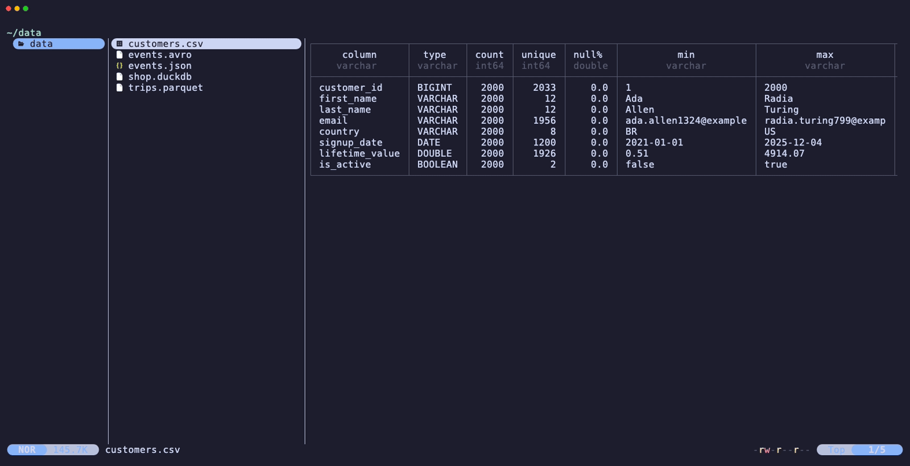

# duckdb.yazi

Preview and summarize data files in [Yazi](https://github.com/sxyazi/yazi) with [DuckDB](https://github.com/duckdb/duckdb).



> [!NOTE]
> This project continues [wylie102/duckdb.yazi](https://github.com/wylie102/duckdb.yazi), created by
> [Thomas Wylie](https://github.com/wylie102). [Steven Carpenter](https://github.com/stevencarpenter) has maintained it since 2026.
> The original work and later changes are distributed under the [MIT License](LICENSE).
>
> DuckDB is a trademark of the DuckDB Foundation. This independent project is not affiliated with or endorsed by the DuckDB Foundation.

## Features

- **Summarized view** (default): one row per column with type, count, unique values, null percentage, min, max, average and other DuckDB `SUMMARIZE` statistics.
- **Standard view**: the file contents as a table, with an optional row number column.
- **Database view**: for a DuckDB database, one row per table with row count, column count, primary key, index count and column names.
- **Row and column scrolling** in all three views.
- **Parquet caches** of both views, built in the background, so scrolling stays fast on large files.
- **Interactive open**: open the hovered file in the DuckDB CLI or the DuckDB UI.
- **Preview hardening**: previews cannot read remote files or download extensions. See [Security](#security).

Supported file types:

| Extension | Notes |
|-----------|-------|
| `.csv`, `.tsv`, `.json`, `.parquet` | Read natively by DuckDB |
| `.avro` | Requires the `avro` extension |
| `.xlsx` | Requires the `spatial` extension (read with `st_read`) |
| `.txt` | Tabular text only. A file that DuckDB reads as one column uses Yazi's text previewer |
| `.duckdb`, `.db` | DuckDB databases, opened read-only |

The plugin detects the file type from the extension only. A file with an unknown extension uses Yazi's text previewer.

## Requirements

| Component | Minimum | Recommended |
|-----------|---------|-------------|
| [Yazi](https://yazi-rs.github.io/docs/installation) | 25.5.28 | 25.5.31 or later (includes fixes in transitive dependencies) |
| [DuckDB CLI](https://duckdb.org/docs/installation/) | 1.5.0 | Latest 1.5.x or 2.x. CI tests 1.5.0, 1.5.6 and 2.0.0 |

DuckDB 1.5.0 includes the fix for [CVE-2025-64429](https://github.com/duckdb/duckdb/security/advisories/GHSA-vmp8-hg63-v2hp) and the `lambda` syntax the plugin uses.

Check your versions:

```sh
yazi --version
duckdb --version
```

## Installation

1. Install the plugin:

   ```sh
   ya pkg add stevencarpenter/duckdb
   ```

   Use this package, not `wylie102/duckdb`. The original repository does not get the fixes in this continuation.

2. Install the DuckDB extensions for `.xlsx` and `.avro` files. Skip this step if you do not preview those types.

   ```sh
   duckdb -c "INSTALL spatial; INSTALL avro;"
   ```

3. Add the previewer and preloader rules to `~/.config/yazi/yazi.toml`:

   ```toml
   [plugin]
   prepend_previewers = [
       { url = "*.csv", run = "duckdb" },
       { url = "*.tsv", run = "duckdb" },
       { url = "*.json", run = "duckdb" },
       { url = "*.parquet", run = "duckdb" },
       { url = "*.avro", run = "duckdb" },
       { url = "*.txt", run = "duckdb" },
       { url = "*.xlsx", run = "duckdb" },
       { url = "*.db", run = "duckdb" },
       { url = "*.duckdb", run = "duckdb" },
   ]

   prepend_preloaders = [
       { url = "*.csv", run = "duckdb", multi = false },
       { url = "*.tsv", run = "duckdb", multi = false },
       { url = "*.json", run = "duckdb", multi = false },
       { url = "*.parquet", run = "duckdb", multi = false },
       { url = "*.avro", run = "duckdb", multi = false },
       { url = "*.txt", run = "duckdb", multi = false },
       { url = "*.xlsx", run = "duckdb", multi = false },
   ]
   ```

   Remove the `*.txt` lines if your `.txt` files never contain tabular data. Database files do not need a preloader rule.

4. Call `setup` in `~/.config/yazi/init.lua`. The plugin does not start without this call, even with no options:

   ```lua
   require("duckdb"):setup()
   ```

5. Add key bindings to `~/.config/yazi/keymap.toml`:

   ```toml
   [[mgr.prepend_keymap]]
   on = "H"
   run = "plugin duckdb -- -1"
   desc = "DuckDB: scroll one column left"

   [[mgr.prepend_keymap]]
   on = "L"
   run = "plugin duckdb -- +1"
   desc = "DuckDB: scroll one column right"

   [[mgr.prepend_keymap]]
   on = ["g", "o"]
   run = "plugin duckdb -- -open"
   desc = "DuckDB: open in the CLI"

   [[mgr.prepend_keymap]]
   on = ["g", "u"]
   run = "plugin duckdb -- -ui"
   desc = "DuckDB: open in the UI"
   ```

   `H` and `L` replace Yazi's default "back" and "forward" bindings. Choose other keys if you use those bindings.

To see more columns, widen the preview pane in `yazi.toml` (Yazi's default is `[1, 4, 3]`):

```toml
[mgr]
ratio = [1, 2, 5]
```

The [toggle-pane](https://github.com/yazi-rs/plugins/tree/main/toggle-pane.yazi) plugin can also maximize the preview pane.

## Usage

| Key | Action |
|-----|--------|
| `J` / `K` | Scroll rows (Yazi's default preview seek keys) |
| `K` at the top of the preview | Switch between summarized and standard view |
| `H` / `L` | Scroll columns (bindings from step 5) |
| `g` `o` | Open the hovered file in the DuckDB CLI |
| `g` `u` | Open the hovered file in the DuckDB UI |

To switch views with one key, bind `plugin duckdb -- -toggle`.

`g o` and `g u` load a data file into a table named after the file (`sales.csv` becomes `sales`). They open a `.duckdb` or `.db` file directly. Yazi is hidden until you exit DuckDB.

### Standard view

The standard view shows the rows of the file. Set `row_id = true` to add a row number column.


### Database view

For a `.duckdb` or `.db` file, the preview lists each table in alphabetical order. Tables outside the `main` schema show as `schema.table`. Column scrolling moves through the list of column names.


### Caching

When you enter a directory, the preloader writes a Parquet cache of both views for each new or changed file. The status bar shows the progress. Until a cache exists, the plugin queries the source file, and the summarized view can be slow on large non-Parquet files. Switch to the standard view or wait for the cache.

In the summarized view, `⏱` marks statistics that are not ready yet. If no preload starts for the file within 30 seconds (for example, because no preloader rule matches it), the view stops waiting. Hover the file again after the cache is built. `∅` marks a cache that failed to build.

## Configuration

Pass options to `setup` in `init.lua`. Each option is optional. These are the defaults:

```lua
require("duckdb"):setup({
  mode = "summarized",
  cache_enabled = true,
  cache_size = 500,
  auto_install_extensions = false,
  row_id = false,
  minmax_column_width = 21,
  column_fit_factor = 10,
})
```

| Option | Default | Effect |
|--------|---------|--------|
| `mode` | `"summarized"` | View at startup: `"summarized"` or `"standard"` |
| `cache_enabled` | `true` | `false` skips the Parquet caches and always queries the source file. Use `false` for sensitive data |
| `cache_size` | `500` | Rows cached for the standard view. Run `yazi --clear-cache` after you change it |
| `auto_install_extensions` | `false` | `true` runs `INSTALL spatial` or `INSTALL avro` before each `.xlsx` or `.avro` preview and allows DuckDB to download extensions. This needs network access |
| `row_id` | `false` | Row number column in the standard view: `true`, `false`, or `"dynamic"` (shown only after you scroll columns) |
| `minmax_column_width` | `21` | Characters shown in the min and max columns of the summarized view. 21 fits a timestamp |
| `column_fit_factor` | `10` | Expected average column width in characters. See below |

### Tune `column_fit_factor`

The plugin requests only the columns that fit the preview pane. It does not know the width of your columns, so it requests `pane_width / column_fit_factor` columns. A smaller value requests more columns. A larger value requests fewer columns and makes queries on very wide tables faster.

The table should extend a little past the right edge of the pane. Then each column scroll shows a new column. If you see the right edge of the table while more columns remain:

1. Lower `column_fit_factor` until the table extends past the right edge on several files.
2. Raise it by 1.

A value of `7.73` shows even the narrowest columns, but queries on tables with many columns are slower.

### Colors

Previews use DuckDB's default result highlighting. Previews start DuckDB with `-init /dev/null`, so `~/.duckdbrc` does not change them.

`g o` and `g u` start a normal DuckDB session that reads `~/.duckdbrc`. To change the colors of those sessions, add [`.highlight_colors`](https://duckdb.org/docs/stable/clients/cli/dot_commands#configuring-the-result-syntax-highlighter) commands to `~/.duckdbrc`:

```text
.highlight_colors layout gray
.highlight_colors column_name magenta bold
.highlight_colors column_type gray
.highlight_colors string_value cyan
.highlight_colors numeric_value green
.highlight_colors temporal_value blue
.highlight_colors footer gray
```

## Security

Previews and preloads start DuckDB with these settings:

- `-init /dev/null` (`NUL` on Windows), so `~/.duckdbrc` cannot change preview output.
- `SET disabled_filesystems = 'HTTPFileSystem,S3FileSystem,HuggingFaceFileSystem,AzureBlobStorageFileSystem,AzureDfsStorageFileSystem'`, which blocks http(s), s3, gs, r2, hf and Azure reads. Local files stay readable.
- `SET autoinstall_known_extensions = false` unless `auto_install_extensions = true`, so a previewed file cannot make DuckDB download an extension.

Remaining risks:

- DuckDB parses every file you preview. Treat downloaded or shared data files as untrusted, and keep DuckDB up to date.
- The Parquet caches keep a copy of previewed data under Yazi's cache directory. Set `cache_enabled = false`, or run `yazi --clear-cache` after you browse sensitive data.
- `g o` and `g u` start a full DuckDB session without the preview settings.

[SECURITY.md](SECURITY.md) has the threat model and the reporting process.

## Upgrading

[CHANGELOG.md](CHANGELOG.md) lists all changes. Releases that need action:

- **2.0.0**: requires Yazi 25.5.28 or later. Upgrade Yazi before you run `ya pkg upgrade`.
- **1.0.0**: requires DuckDB CLI 1.5.0 or later. Upgrade DuckDB before you run `ya pkg upgrade`.
- **Before 1.0.0**: previewer and preloader rules use `url` instead of `name`. Update the rules in `yazi.toml` to match [step 3](#installation).

## Development

```sh
./scripts/smoke-test.sh   # check DuckDB integration and preview hardening
lua tests/peek_test.lua   # run the plugin against DuckDB with Yazi stand-ins
./scripts/check-cve.sh    # list DuckDB advisories from OSV
./scripts/record-demo.sh  # record docs/demo.gif with vhs from docs/demo/
```

CI runs the smoke test and `tests/peek_test.lua` on DuckDB 1.5.0, 1.5.6 and 2.0.0.
